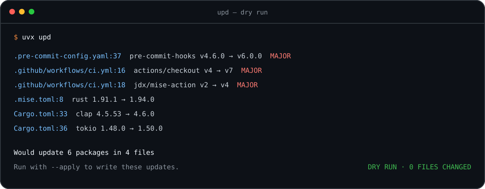

<p align="center">
  
</p>

# upd

<p align="center">
  <strong>Update dependencies across a polyglot repository—locally, safely, and in one command.</strong>
</p>

<p align="center">
  Python · Node.js · Rust · Go · Ruby · .NET · Gradle · Docker · Terraform · Nix flakes · GitHub Actions · pre-commit · Mise
</p>

[](https://crates.io/crates/upd)
[](https://pypi.org/project/upd/)
[](https://github.com/rvben/upd/actions/workflows/ci.yml)
[](https://github.com/rvben/upd/blob/main/LICENSE)

`upd` gives you one reviewable update plan across mixed stacks. It preserves
hand-written constraints, comments, and formatting; previews every proposed
change before it writes; and runs without a hosted service or repository
onboarding.

## Try it now

From any directory inside a Git repository:

```bash
uvx upd
```

That first run is a dry run: it reports what would change and leaves every file
untouched. No repository onboarding or hosted account is required. Review the
plan, then apply it with `uvx upd --apply`.

<p align="center">
  
</p>

<p align="center">
  <sub>One preview across four file types. Nothing changes until you pass <code>--apply</code>.</sub>
</p>

<p align="center">
  <a href="#installation">Install another way</a> ·
  <a href="https://github.com/rvben/upd/blob/main/docs/ecosystems.md">See every supported file</a> ·
  <a href="https://github.com/rvben/upd/blob/main/docs/comparison.md">Compare dependency tools</a>
</p>

## Why upd

- **One command for a mixed stack.** Check application dependencies, tool
  versions, container images, GitHub Actions, pre-commit hooks, and Terraform
  modules in the same run instead of assembling a different updater for each
  file type.
- **Safe on the first run.** Dry-run is the default, constraints and formatting
  are preserved, and major updates are called out before you decide what to
  apply.
- **Local first, automation ready.** Start with an interactive terminal review,
  then use the same CLI, configuration, stable exit codes, JSON/SARIF output,
  and rolling PR or MR workflows in CI.

`upd` is a local checker and editor, not a package manager or a hosted update
bot. It can delegate lockfile refreshes to the package managers already in your
project and can run inside your own GitHub or GitLab automation. A refresh
writes the lockfile without installing packages or syncing an environment;
the exact command per ecosystem, and the one old bun release that is the
exception, are listed under [Commands run by `--lock`](https://github.com/rvben/upd/blob/main/docs/stability.md#commands-run-by---lock). See the
[decision guide and dated benchmarks](https://github.com/rvben/upd/blob/main/docs/comparison.md)
for an exact comparison with adjacent tools.

For uv projects, `upd update --apply --lock` runs exactly `uv lock` after
changing a manifest with an existing lockfile (at the workspace root when
applicable). It passes no flags and never runs `uv sync`; synchronize your
Python environment separately. Without `--lock`, a normal update refreshes
neither the lockfile nor the environment. `upd audit --fix-audit --apply`
refreshes applicable lockfiles by default; `--no-lock` opts out.

## Where upd fits

Choose by the job rather than treating every dependency tool as interchangeable:

| If you need to… | Start with… |
|---|---|
| Preview and edit versions across a mixed-language repository from one local command | **upd** |
| Resolve, lock, install, and manage a Python environment | [uv](https://github.com/astral-sh/uv) or [PDM](https://github.com/pdm-project/pdm) |
| Continuously create update branches and PRs across the broadest manager catalog | [Renovate](https://github.com/renovatebot/renovate) or Dependabot |
| Enforce immutable GitHub Actions references as a dedicated policy | [pinact](https://github.com/suzuki-shunsuke/pinact) or [ratchet](https://github.com/sethvargo/ratchet) |

### Dated performance evidence

On the committed 18-reference fixture, the verified 2026-08-28 run recorded:

| Workload | upd mean | Same-workload cohort |
|---|---:|---:|
| Check 12 Python constraints | **134.7 ms** | uppd: 269.7 ms |
| Update 12 Python constraints | **138.7 ms** | uppd: 250.8 ms |
| Check 6 GitHub Actions | **758.7 ms** | taze: 1,019.0 ms; ratchet: 1,029.1 ms |
| Update 6 GitHub Actions | 746.3 ms | **taze: 566.3 ms**; ratchet: 1,066.8 ms |

Lower is better. These are five-run live-network observations, not universal
speed claims. Every timed update was first verified to change all intended
references and leave a parseable result. See the
[full matrix, methodology, variance, commands, and raw JSON](https://github.com/rvben/upd/blob/main/docs/comparison.md).

## Features

- **Multi-ecosystem**: Python, Node.js (npm, pnpm, Yarn and Bun lockfiles), Deno, Rust, Go, Ruby, .NET,
  Gradle, Docker, Terraform, Nix flakes, GitHub Actions, pre-commit, Mise/asdf
- **Dry-run by default**: nothing is written without `--apply`
- **Fast**: parallel registry requests, with a 24-hour version cache
- **Constraint-aware**: respects `>=2.0,<3` (Python), `~> 7.1` (Ruby), and `^2.0.0` / `~2.0.0` (npm, Cargo)
- **Format-preserving**: keeps formatting, comments, and structure
- **Update filters**: `--only-bump`, `--max-bump`, `--package` (exact names or quoted globs such as `'shiny*'`),
  `--lang`, `--exclude-lang`, or approve one by one with `-i`
- **Major warnings**: breaking changes are flagged with `(MAJOR)`
- **Pre-release aware**: updates pre-releases to newer pre-releases
- **Cooldown**: hold back releases younger than N days, against supply-chain attacks
- **Security auditing**: OSV vulnerability scanning with auto-fix and SARIF output
- **Check mode**: exit 1 if updates are available (for CI and pre-commit)
- **Gitignore-aware**: honors `.gitignore` and prunes hidden directories, without missing the dotfiles it updates
- **Private registries**: authentication for PyPI, npm, Cargo, Go, and GitHub
- **Config file**: include or exclude paths, ignore packages, and pin versions via `.updrc.toml`

## Installation

### Homebrew

```sh
brew install rvben/tap/upd
```

### From crates.io

```bash
cargo install upd

# or with cargo-binstall (faster, pre-built binary)
cargo binstall upd
```

### From PyPI

```bash
pip install upd
# or with uv
uv pip install upd
```

If you installed an earlier release under the old distribution name, migrate
once with `pip uninstall upd-cli && pip install upd`. The `upd-cli` command
remains available as a compatibility alias.

### From source

```bash
git clone https://github.com/rvben/upd
cd upd
cargo install --path .
```

## Usage

```bash
# Preview changes without modifying files (default when no --apply)
upd

# Apply updates to files
upd --apply

# Limit to specific files or directories
upd --apply requirements.txt pyproject.toml

# Approve updates one by one
upd -i

# Only the packages you name
upd -p requests,flask

# Select a package family (quote globs so your shell passes them to upd)
upd --package 'shiny*'

# Cap the bump level (allow patch + minor, skip major). Updates above the
# ceiling are reported as held back, never as up to date, and do not
# change the exit code.
upd --max-bump minor

# Restrict to exactly one level (repeatable, comma-separated)
upd --only-bump major

# Write nothing but registry versions at that level: pins, flake revisions
# and other level-less writes are reported as held instead of written
upd --only-bump major --strict-bump

# One ecosystem at a time: python, node, rust, go, ruby, dot-net,
# docker, terraform, nix, actions, pre-commit, mise, annotated
upd --lang python

# Both pre-commit YAML and prek.toml, including supported hook dependencies
upd --lang prek

# Exit 1 if anything is outdated (for CI and pre-commit)
upd --check

# Also reject unsafe or unverifiable dependencies blocked by safety checks
upd --check --fail-on-blocked

# Regenerate lockfiles after writing; a failed refresh rolls its directory back
upd --apply --lock

# Print the effective configuration and exit
upd --show-config
```

`--fail-on-blocked` is supported only by `upd update` or the default `upd`
invocation. `--check --fail-on-blocked` exits 1 for safety refusals and 2 for
failed registry requests. Unsupported Docker digest pins and bare pre-commit
commit pins remain `not-examined` and do not fail this check. Pre-commit pins
with a `# frozen: <tag>` comment are verified and updated together with that
comment; a mismatch fails the strict check. The reusable workflow's
`fail-on-blocked` input additionally covers unfixable or skipped version floors
and blocked security relocks; see [GitHub Actions](https://github.com/rvben/upd/blob/main/docs/github-actions.md).

`upd --help` lists every flag; [Stability](https://github.com/rvben/upd/blob/main/docs/stability.md)
documents the ones that are contractual, and `upd schema` emits the whole
interface as JSON.

`--package` accepts exact names and case-sensitive globs using `*`, `?`, and
character classes such as `[ab]`. Wildcards can cross namespace separators, so
patterns such as `'@scope/*'` and `'github.com/org/*'` work as expected. Quote
globs on the command line to prevent shell expansion. A glob that matches no
package produces a warning without changing the exit code; use repeated or
comma-separated values instead of brace alternation.

> **Dry-run by default**: `upd` without `--apply` only previews changes. Pass `--apply` to
> write updates. `--check`, `--dry-run`, and `--interactive` do not require `--apply`.
>
> **VCS-root scoping**: When no path argument is given, `upd` scans from the nearest `.git`
> ancestor directory rather than the current working directory. This prevents accidental
> rewrites when CWD is a subdirectory inside a repository.

### Commands

```bash
upd --version      # Print version
upd self-update    # Check for upd updates
upd clean-cache    # Clear the version cache
upd lock-refresh   # Refresh uv, npm, and Cargo locks within manifest constraints
upd align          # Align versions across files (--check exits 1 on misalignment)
upd audit          # Scan for known vulnerabilities (exit 6 if found)
upd schema         # Machine-readable interface description
```

For repositories replacing dependency bots, `upd` also provides separate
reusable GitHub workflows for policy-constrained freshness updates and
validated security-remediation pull requests. See
[GitHub dependency pull requests](https://github.com/rvben/upd/blob/main/docs/github-actions.md).

## Example Output

<details>
<summary>Six proposed updates across four files</summary>

```text
.pre-commit-config.yaml:37: Would update pre-commit/pre-commit-hooks v4.6.0 → v6.0.0 (MAJOR)
.github/workflows/ci.yml:16: Would update actions/checkout v4 → v6 (MAJOR)
.github/workflows/ci.yml:18: Would update jdx/mise-action v2 → v4 (MAJOR)
.mise.toml:8: Would update rust 1.91.1 → 1.94.0
Cargo.toml:33: Would update clap 4.5.53 → 4.6.0
Cargo.toml:36: Would update tokio 1.48.0 → 1.50.0

Would update 6 package(s) (2 major, 3 minor, 1 patch) in 4 file(s), 8 up to date
```

</details>

Output includes clickable `file:line:` locations (recognized by VS Code, iTerm2,
and modern terminals).

## Version Constraints

By default, `upd` preserves each constraint’s shape. For bounded ranges, it moves
the inclusive lower bound within the existing range and keeps its ceiling.
Exact pins can move to a newer release. To freeze
a package, use `[pin]` or `ignore` in `.updrc.toml`.

| Constraint | Behavior |
| --- | --- |
| `>=2.0,<3` | Updates the lower bound within 2.x; keeps the `<3` ceiling |
| `^2.0.0` | A complete caret version keeps its caret ceiling |
| `~2.0.0` | Keeps the existing tilde constraint’s ceiling |
| `==2.0.0` | Updates the exact pin; an exact pin is not a freeze |
| `==2.0.*` | Checks and reports the series without rewriting it |

[Full constraint behavior](https://github.com/rvben/upd/blob/main/docs/versions.md#version-constraints), including npm
range shapes, Python bump labels and opt-in specifier normalization. Partial npm ranges such as `^1.2` can move
to a new major while preserving the operator and number of components.

### Bounds that are not floors

Exclusive lower bounds, upper bounds, exclusions, OR ranges and PEP 440 prefix
matches have no single release floor to rewrite. They are still checked and
reported: up to date, a warning when outgrown, or an error for unreadable specs.
See [outcomes and examples](https://github.com/rvben/upd/blob/main/docs/versions.md#bounds-that-are-not-floors).

## Annotated Version Pins

Update a version in an otherwise unrecognized file with an annotation:

```yaml
shinyhub_version: "0.11.16"  # upd: pypi shinyhub
```

[Annotation reference](https://github.com/rvben/upd/blob/main/docs/versions.md#annotated-version-pins): file discovery,
Dockerfile rules, linked release checksums, validation and initialization tools.

## Version Precision

By default, `upd` preserves the number of version components already written.
Use `--full-precision` to output full semver versions instead.
See [precision examples](https://github.com/rvben/upd/blob/main/docs/versions.md#version-precision).

## Version Alignment

`upd align --dry-run` previews alignment to the highest version already found
across files in the same ecosystem. `upd align` applies it; `upd align --check`
exits with status 1 when versions differ. Upper-bound constraints are skipped,
and prerelease versions are ignored when selecting the highest version.
See [alignment examples](https://github.com/rvben/upd/blob/main/docs/versions.md#version-alignment).

## Pre-commit Integration

Add `upd` to your `.pre-commit-config.yaml`:

```yaml
repos:
  - repo: https://github.com/rvben/upd-pre-commit
    rev: v0.0.24
    hooks:
      - id: upd-check
        # Optional: only check specific ecosystems
        # args: ['--lang', 'python']
```

Available hooks:

| Hook ID | Description |
|---------|-------------|
| `upd-check` | Fail if any dependencies are outdated |
| `upd-check-major` | Fail only on major (breaking) updates |

Both hooks run on `pre-push` by default. Uses `language: python` which installs `upd` from PyPI automatically, so no manual installation is needed.

## Documentation

Everything you look up rather than read lives in
[docs/](https://github.com/rvben/upd/tree/main/docs).

### Version behavior and annotations

Constraint semantics, annotated pins and checksums, version precision, and
alignment across files.
→ [docs/versions.md](https://github.com/rvben/upd/blob/main/docs/versions.md)

### Releases

Vership workflow, publication guarantees, automated integration pins, and safe
retry procedures.
→ [docs/releases.md](https://github.com/rvben/upd/blob/main/docs/releases.md)

### Supported files

Every file `upd` discovers, per ecosystem, plus annotated version pins in files
it does not otherwise understand.
→ [docs/ecosystems.md](https://github.com/rvben/upd/blob/main/docs/ecosystems.md)

### Comparison and benchmarks

A dated feature matrix for related dependency tools, plus workload-based,
reproducible benchmarks that avoid ranking unlike operations.
→ [docs/comparison.md](https://github.com/rvben/upd/blob/main/docs/comparison.md)

### Security auditing

OSV vulnerability scanning, `--fix-audit`, SARIF output, and CI integration.
→ [docs/audit.md](https://github.com/rvben/upd/blob/main/docs/audit.md)

### Security policy

Private vulnerability reporting, supported versions, trust boundaries, and
release integrity.
→ [SECURITY.md](https://github.com/rvben/upd/blob/main/SECURITY.md)

### Configuration file

`.updrc.toml` discovery order and every key it accepts.
→ [docs/configuration.md](https://github.com/rvben/upd/blob/main/docs/configuration.md)

### Cooldown (minimum release age)

Hold back versions published less than N days ago, per ecosystem or per language,
and keep `--lock` refreshes to the same cooldown.
→ [docs/configuration.md#cooldown-minimum-release-age](https://github.com/rvben/upd/blob/main/docs/configuration.md#cooldown-minimum-release-age)

### Caching

Where the 24-hour version cache lives and how to clear or bypass it.
→ [docs/configuration.md#caching](https://github.com/rvben/upd/blob/main/docs/configuration.md#caching)

### Environment variables

Every variable `upd` reads, in one table.
→ [docs/configuration.md#environment-variables](https://github.com/rvben/upd/blob/main/docs/configuration.md#environment-variables)

### Private repositories

Credential detection for PyPI, npm, Cargo, Go, and GitHub, including private
indexes declared in `pyproject.toml`.
→ [docs/private-registries.md](https://github.com/rvben/upd/blob/main/docs/private-registries.md)

### GitHub pull requests

Run any supported dependency updates as one rolling GitHub PR, with immutable
Action SHA verification, validation, artifact reporting, and opt-in auto-merge.
→ [docs/github-actions.md](https://github.com/rvben/upd/blob/main/docs/github-actions.md)

### GitLab merge requests

Run scheduled dependency updates as one rolling GitLab MR, with validation,
lease-protected branch updates, and explicitly opt-in GitLab-native auto-merge.
→ [docs/gitlab.md](https://github.com/rvben/upd/blob/main/docs/gitlab.md)

### Stability

The stable CLI surface, exit codes, `--lock` commands, and output guarantees.
→ [docs/stability.md](https://github.com/rvben/upd/blob/main/docs/stability.md)

## Development

```bash
# Build
make build

# Run tests
make test

# Lint
make lint

# Format
make fmt

# All checks
make check
```

## License

MIT
